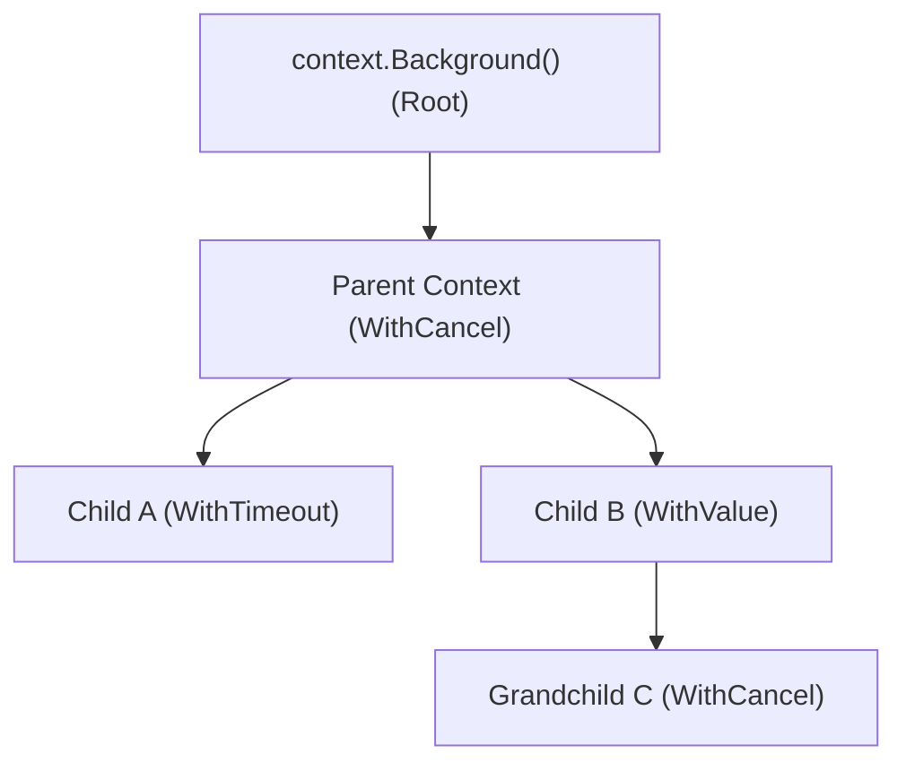
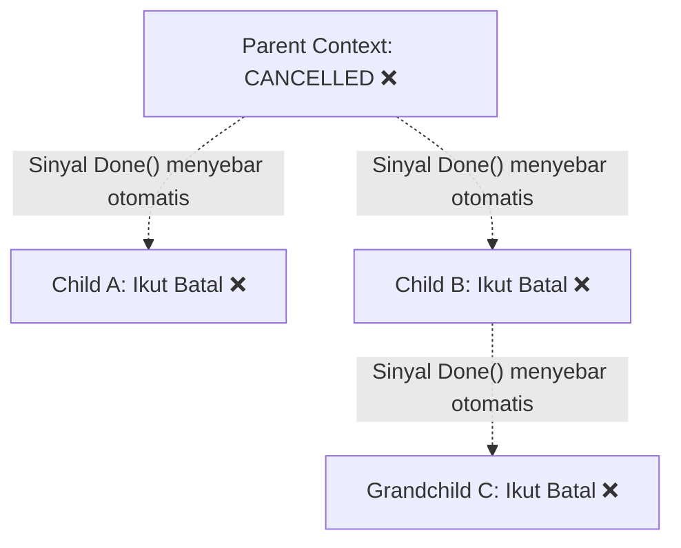
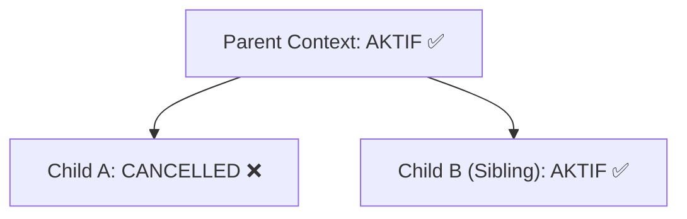

# 01. Parent & Child Context

Konsep paling mendasar yang perlu dipahami dari package `context` di Go adalah struktur **Tree (Pohon Konteks)** dan bagaimana sinyal pembatalan (*cancellation signal*) disebarkan ke seluruh cabang pohon tersebut.

---

## 1. Konsep Pohon Konteks (Context Tree)

Di Go, setiap context diturunkan dari context lainnya, dimulai dari root context:
- `context.Background()`: Root context kosong tingkat atas yang biasanya diinisialisasi pada `main()`, worker root, atau request HTTP masuk.
- `context.TODO()`: Digunakan saat kita belum yakin context mana yang tepat atau ketika kode sedang dalam tahap refactoring.

Setiap kali Anda memanggil fungsi turunan seperti `WithCancel`, `WithTimeout`, `WithDeadline`, atau `WithValue`, Go menciptakan **Child Context** baru yang merujuk pada **Parent Context** sebelumnya.



---

## 2. Aturan Propagasi Pembatalan (Cancellation Propagation)

Terdapat 2 aturan emas propagasi hierarki context:

### Aturan 1: Pembatalan Parent Merambat ke Bawah (Top-Down)
Jika sebuah Parent Context dibatalkan (baik secara manual via `cancel()` atau karena timeout/deadline habis), **seluruh child dan keturunan di bawahnya otomatis ikut dibatalkan**.



### Aturan 2: Pembatalan Child Terisolasi (Tidak Merambat ke Atas atau Samping)
Jika sebuah Child Context dibatalkan, **Parent dan Sibling (saudara)-nya TIDAK terpengaruh sama sekali** dan tetap aktif berjalan normal.



---

## 3. Contoh Kode: Propagasi Pembatalan

Berikut contoh bagaimana pembatalan parent merambat ke semua anaknya:

```go
package main

import (
	"context"
	"fmt"
	"time"
)

func main() {
	// 1. Buat parent context
	parentCtx, cancelParent := context.WithCancel(context.Background())

	// 2. Buat child context dari parent
	childCtx, cancelChild := context.WithTimeout(parentCtx, 5*time.Second)
	defer cancelChild()

	// 3. Batalkan parent
	cancelParent()

	// 4. Periksa status child
	select {
	case <-childCtx.Done():
		fmt.Println("Child otomatis batal karena parent dibatalkan:", childCtx.Err())
		// Output: context canceled
	default:
		fmt.Println("Child masih berjalan")
	}
}
```

---

## 4. Kapan Menggunakan Parent & Child Context?

1. **HTTP Handler Lifecycle**: Request HTTP dari `http.Request.Context()` bertindak sebagai Parent. Saat memanggil database atau microservice lain, buat child context dengan timeout khusus untuk operasi tersebut.
2. **Fan-Out Worker Pool**: Jika satu proses utama memicu 10 goroutine worker, jadikan context proses utama sebagai parent. Jika terjadi error kritis di salah satu worker, parent dapat dibatalkan untuk menghentikan 9 worker lainnya seketika.
