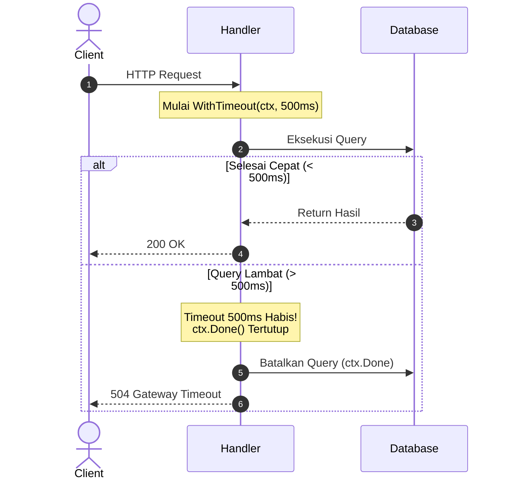

# 04. Context with Timeout (`context.WithTimeout`)

`context.WithTimeout` digunakan untuk membatasi durasi maksimal eksekusi sebuah operasi secara otomatis. Jika operasi tidak selesai dalam durasi yang ditentukan, Go akan otomatis membatalkan context tersebut.

---

## 1. Mekanisme Kerja

Sintaks dasar:
```go
ctx, cancel := context.WithTimeout(parentCtx, 2*time.Second)
defer cancel() // Tetap wajib defer cancel() untuk membersihkan timer jika operasi selesai lebih awal
```

Perilaku context:
1. **Otomatis Dibatalkan**: Jika waktu melebihi durasi timeout, channel `ctx.Done()` akan tertutup otomatis, dan `ctx.Err()` bernilai `context.DeadlineExceeded`.
2. **Selesai Lebih Cepat**: Jika operasi selesai sebelum durasi habis, pemanggilan `defer cancel()` akan menghentikan timer internal, sehingga timer tidak menggantung di memori.

---

## 2. Diagram Alir Timeout



---

## 3. Contoh Nyata 1: Pemanggilan HTTP Client dengan Timeout

Membuat HTTP request ke pihak ketiga dengan batas waktu ketat:

```go
func CallPaymentAPI(ctx context.Context, payload []byte) (*http.Response, error) {
	// Buat child context dengan batas waktu SLA maksimal 2 detik
	reqCtx, cancel := context.WithTimeout(ctx, 2*time.Second)
	defer cancel()

	req, err := http.NewRequestWithContext(reqCtx, http.MethodPost, "https://api.payment.com/v1/charge", bytes.NewBuffer(payload))
	if err != nil {
		return nil, err
	}

	client := &http.Client{}
	resp, err := client.Do(req)
	if err != nil {
		if errors.Is(err, context.DeadlineExceeded) {
			return nil, fmt.Errorf("payment gateway timeout melebihi 2s: %w", err)
		}
		return nil, fmt.Errorf("gagal menghubungi payment gateway: %w", err)
	}

	return resp, nil
}
```

---

## 4. Contoh Nyata 2: Operasi Database dengan Timeout

Mencegah query lambat atau table lock membuat koneksi database pool habis:

```go
func (r *Repo) FindUserByID(ctx context.Context, id string) (*User, error) {
	// Buat timeout khusus query DB
	dbCtx, cancel := context.WithTimeout(ctx, 800*time.Millisecond)
	defer cancel()

	var user User
	// Driver database/sql Go standar secara otomatis menghormati context
	err := r.db.QueryRowContext(dbCtx, "SELECT id, name FROM users WHERE id = $1", id).Scan(&user.ID, &user.Name)
	if err != nil {
		if errors.Is(err, context.DeadlineExceeded) {
			return nil, fmt.Errorf("database query timeout: %w", err)
		}
		return nil, err
	}

	return &user, nil
}
```

---

## 5. Membedakan `context.Canceled` vs `context.DeadlineExceeded`

Anda dapat memeriksa jenis error pembatalan dengan `errors.Is`:

```go
if errors.Is(ctx.Err(), context.DeadlineExceeded) {
	// Terjadi karena batas durasi waktu habis
	w.WriteHeader(http.StatusGatewayTimeout) // 504
} else if errors.Is(ctx.Err(), context.Canceled) {
	// Terjadi karena user membatalkan koneksi atau cancel() dipanggil manual
	w.WriteHeader(499) // Client Closed Request
}
```
